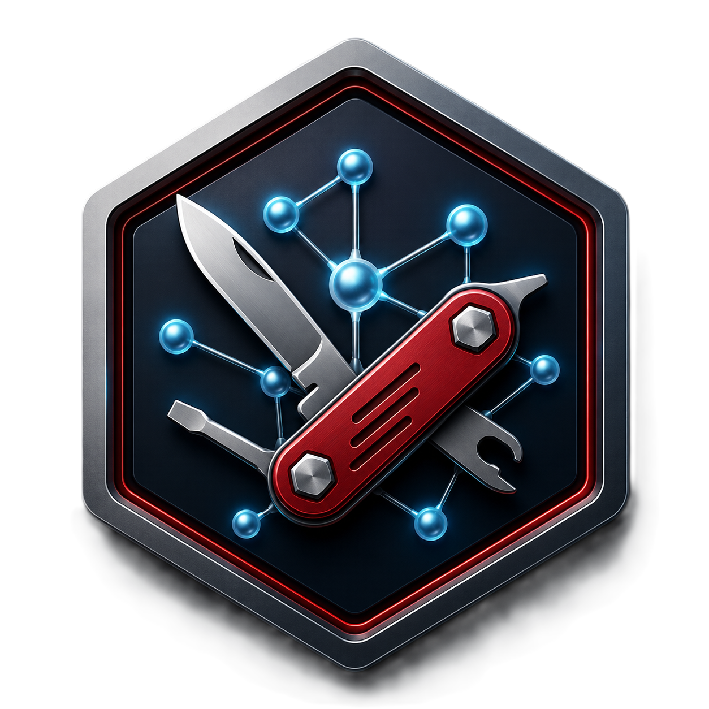
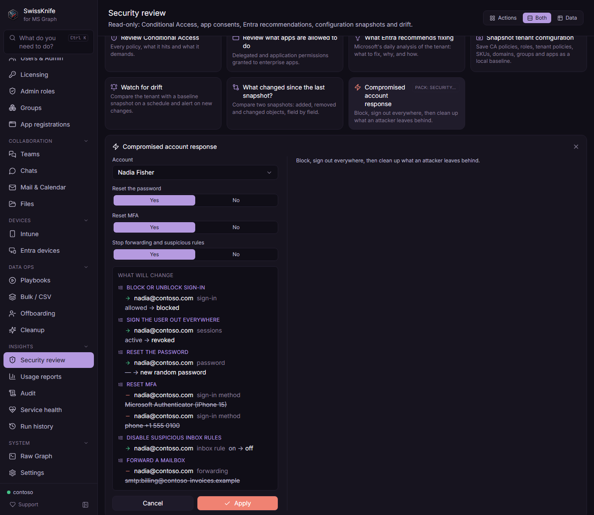
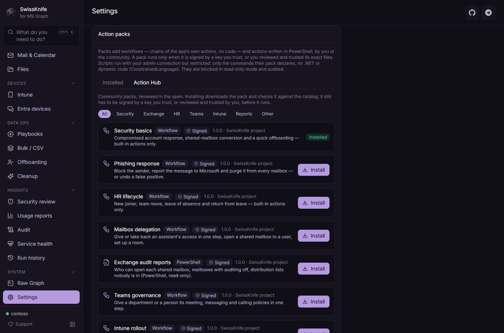
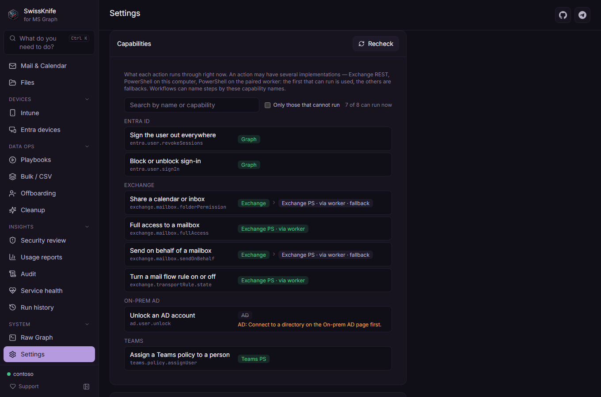
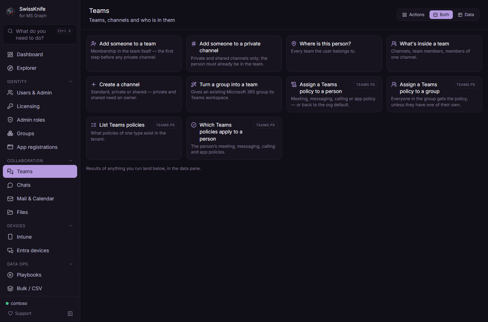
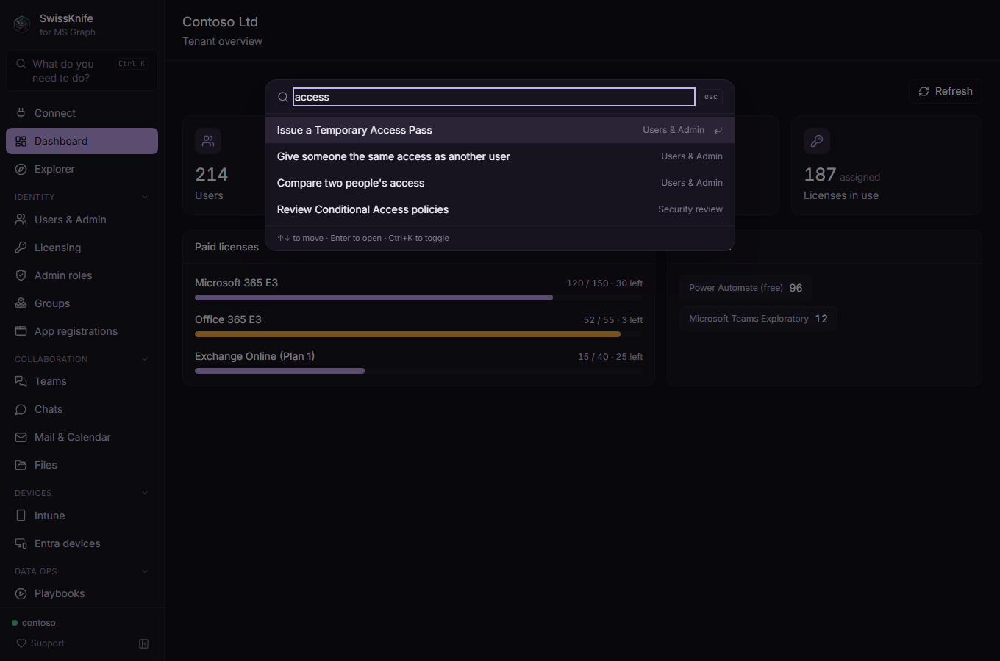
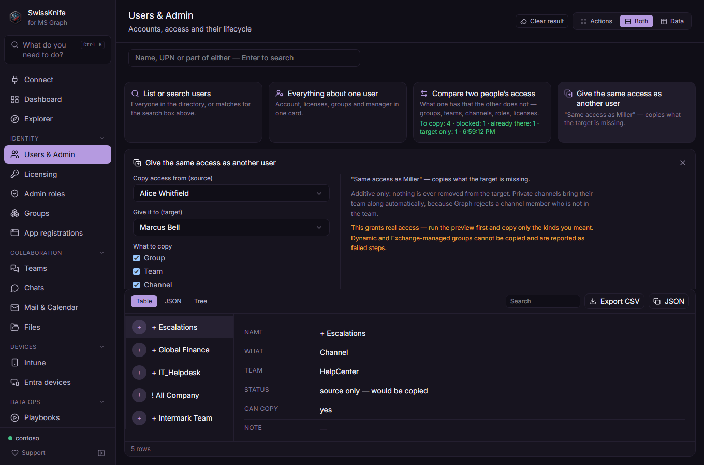
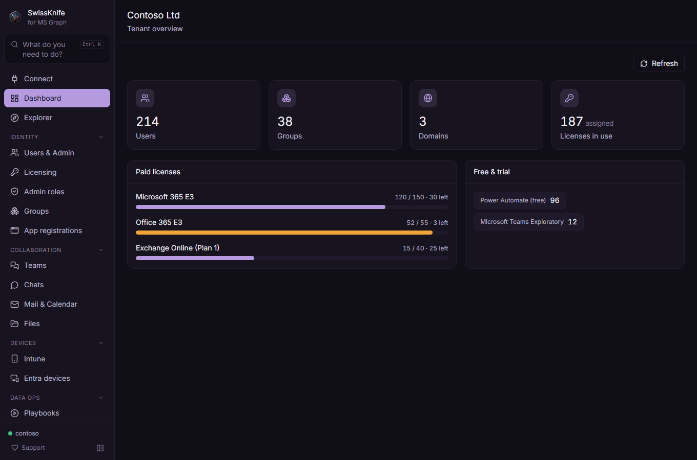

<h1 align="center">
  
</h1>

<p align="center">
  <b>Microsoft 365 administration as previewed, audited tasks</b><br />
  Graph · Exchange &amp; Teams PowerShell · on-prem Active Directory · action packs<br />
  Windows · macOS · Linux — free, MIT
</p>

<p align="center">
  <a href="https://github.com/Nemu-x/SwissKnife-for-MS-Graph/releases/latest">Download</a> ·
  <a href="https://github.com/Nemu-x/SwissKnife-for-MS-Graph/wiki">Wiki</a> ·
  <a href="https://github.com/Nemu-x/SwissKnife-Action-Hub">Action Hub</a> ·
  <a href="https://t.me/nemux_dev">Telegram</a> ·
  <a href="#support">Support</a>
</p>

<p align="center">
  
</p>

## Why

- **See every change before it happens.** Each action — a Graph call, an Exchange or Teams
  cmdlet, an LDAP write — shows exactly what will change (before → after, per object), asks
  for one confirmation (typed for anything destructive), then writes a run journal and an
  audit log.
- **Exchange and Teams PowerShell as buttons.** Mailbox permissions, shared mailboxes,
  forwarding, transport rules, Teams policies. PowerShell 7 and the modules install from the
  app; a paired Windows machine can run them for a Mac or Linux box.
- **Tasks, not endpoints.** Every page is a grid of jobs ("give the same access as another
  user", "why can this person not sign in?"). Press **Ctrl+K** and describe the task.
- **Incident response and config as code.** Purge a phishing mail tenant-wide, kill
  sessions and suspicious rules in one workflow; snapshot Conditional Access, Intune,
  Exchange and Teams settings, diff them, watch for drift and restore.
- **Extensible.** Install community workflows and reports from the
  [Action Hub](https://github.com/Nemu-x/SwissKnife-Action-Hub), or write your own.
- **One binary, GUI and CLI.** The same actions run headless for scripts and scheduled tasks.

## Screenshots

<table>
  <tr>
    <td width="50%"><br /><sub><b>Action Hub</b> — community packs by category, signed, installed in one click</sub></td>
    <td width="50%"><br /><sub><b>Capabilities</b> — what each action runs through right now, and the fallbacks</sub></td>
  </tr>
  <tr>
    <td width="50%"><br /><sub><b>Task pages</b> — Graph and PowerShell actions side by side</sub></td>
    <td width="50%"><br /><sub><b>Ctrl+K</b> — describe the task, land on the form that does it</sub></td>
  </tr>
  <tr>
    <td width="50%"><br /><sub><b>Access mirror</b> — diff two people, copy only what is missing</sub></td>
    <td width="50%"><br /><sub><b>Dashboard</b> — counts and license usage, each number opens its list</sub></td>
  </tr>
</table>

<sub>Generated from the production bundle with stubbed data — no tenant involved.</sub>

## Install

| Platform | Download |
| --- | --- |
| Windows x64 | [installer](https://github.com/Nemu-x/SwissKnife-for-MS-Graph/releases/latest/download/SwissKnifeGraph-windows-amd64-installer.exe) · [portable](https://github.com/Nemu-x/SwissKnife-for-MS-Graph/releases/latest/download/SwissKnifeGraph-windows-amd64-portable.exe) |
| Windows ARM64 | [installer](https://github.com/Nemu-x/SwissKnife-for-MS-Graph/releases/latest/download/SwissKnifeGraph-windows-arm64-installer.exe) · [portable](https://github.com/Nemu-x/SwissKnife-for-MS-Graph/releases/latest/download/SwissKnifeGraph-windows-arm64-portable.exe) |
| macOS | [Apple Silicon](https://github.com/Nemu-x/SwissKnife-for-MS-Graph/releases/latest/download/SwissKnifeGraph-macos-arm64.dmg) · [Intel](https://github.com/Nemu-x/SwissKnife-for-MS-Graph/releases/latest/download/SwissKnifeGraph-macos-intel.dmg) |
| Linux x64 | [AppImage](https://github.com/Nemu-x/SwissKnife-for-MS-Graph/releases/latest/download/SwissKnifeGraph-x86_64.AppImage) · [deb](https://github.com/Nemu-x/SwissKnife-for-MS-Graph/releases/latest/download/SwissKnifeGraph-linux-amd64.deb) · [rpm](https://github.com/Nemu-x/SwissKnife-for-MS-Graph/releases/latest/download/SwissKnifeGraph-linux-amd64.rpm) · [tar.gz](https://github.com/Nemu-x/SwissKnife-for-MS-Graph/releases/latest/download/SwissKnifeGraph-linux-amd64.tar.gz) |
| Linux ARM64 | [AppImage](https://github.com/Nemu-x/SwissKnife-for-MS-Graph/releases/latest/download/SwissKnifeGraph-aarch64.AppImage) · [deb](https://github.com/Nemu-x/SwissKnife-for-MS-Graph/releases/latest/download/SwissKnifeGraph-linux-arm64.deb) · [rpm](https://github.com/Nemu-x/SwissKnife-for-MS-Graph/releases/latest/download/SwissKnifeGraph-linux-arm64.rpm) · [tar.gz](https://github.com/Nemu-x/SwissKnife-for-MS-Graph/releases/latest/download/SwissKnifeGraph-linux-arm64.tar.gz) |
| Arch (AUR) | `yay -S swissknife-graph-bin` |
| winget | `winget install Nemu-x.SwissKnifeGraph` *(awaiting approval in winget-pkgs)* |

- **Not code-signed yet.** Windows SmartScreen says *Unknown publisher* (More info → Run
  anyway); on macOS run the bundled "Fix Quarantine.command" or
  `sudo xattr -r -d com.apple.quarantine "/Applications/SwissKnifeGraph.app"`.
- **Verify** with the signed checksums: `minisign -Vm SHA256SUMS.txt -P $(cat minisign.pub)`
  then `sha256sum -c SHA256SUMS.txt` ([`minisign.pub`](minisign.pub)). The in-app updater
  does this check itself.
- **Linux:** deb/rpm/tar.gz need `webkit2gtk-4.1` and `gtk3`; the AppImage bundles them
  (glibc 2.35+).

## Quick start

1. **Register an app** in Entra ID: Tenant ID, Client ID and either a client secret /
   certificate (app-only) or device-code sign-in (delegated). Grant only the permissions
   for what you use — the [Permissions](https://github.com/Nemu-x/SwissKnife-for-MS-Graph/wiki/Permissions)
   page maps each feature to its permission.
2. **Connect** and save the profile. Optionally make it read-only or limit it to members of
   chosen groups.
3. **Ctrl+K** and type what you need. For Exchange/Teams tasks, *Settings → PowerShell*
   installs PowerShell 7 and the modules.

## What it covers

| Area | Highlights |
| --- | --- |
| Users & access | create, block, reset password and MFA, revoke sessions, manager, licenses, admin roles, restore; **access mirror** between two people |
| Exchange | Full Access, Send As / on behalf, calendar and folder permissions, shared mailboxes, forwarding, addresses, rooms, distribution lists, transport rules, message trace |
| Teams | channels, membership, Teamify, meeting / messaging / calling / app policies for people and groups |
| Security | phishing purge, suspicious inbox rules, block senders, quarantine, compromised-account workflow; Conditional Access read as facts; app consents |
| Intune & devices | what is assigned to whom, unassigned policies, conflicts, assign/unassign; wipe, retire, BitLocker keys |
| Config as code | snapshots, git export, diff, drift alerts, restore of a section or everything since a snapshot |
| Files | OneDrive/SharePoint browse, upload, sharing links; offboarding copy; duplicate and version-bloat cleanup |
| Reports | inactive users, license waste, MFA status, guests, privileged roles, mailbox sizes and forwarding — across several tenants |
| On-prem AD | find, disable/enable, unlock, reset passwords, group membership (LDAPS) |
| Playbooks | onboarding with role profiles, offboarding, compromised account — live, cancellable |

## Action packs and the Action Hub

- **Workflows** chain built-in actions without code: one preview, one confirmation, every step
  keeping its own permissions and limits.
- **Script packs** add PowerShell actions, sandboxed: only the commands the pack declares, in
  ConstrainedLanguage, never on the worker.
- **[Action Hub](https://github.com/Nemu-x/SwissKnife-Action-Hub)** (*Settings → Action packs*):
  phishing response, HR lifecycle, mailbox delegation, Teams governance, Intune rollout, Exchange
  and Teams audit reports and more. Hub packs are signed with the project's pack key; anything
  else runs only after you review and trust it. Contributions welcome.

## Command line

```powershell
SwissKnifeGraph action list
SwissKnifeGraph action mailbox.fullAccess mailbox=shared@contoso.com user=alice@contoso.com          # preview
SwissKnifeGraph action mailbox.fullAccess mailbox=shared@contoso.com user=alice@contoso.com --apply  # apply
SwissKnifeGraph signins alice@contoso.com --failed --days 3
SwissKnifeGraph get '/users?$select=displayName,userPrincipalName' --all --json
```

Uses a profile saved in the GUI (`--profile <name>`); same engine, journal and audit log.
See [Command line](https://github.com/Nemu-x/SwissKnife-for-MS-Graph/wiki/CLI).

## Security model

- Secrets live in the OS keychain; tokens stay in the Go backend and only go to Microsoft.
- Every write is previewed; destructive ones need the target typed back; everything is
  journaled and audited locally.
- Read-only mode and per-profile limits (max danger, group scope) are enforced in the backend.
- Updates and Action Hub packs are signature-checked; pack scripts are sandboxed.

More in the [Security](https://github.com/Nemu-x/SwissKnife-for-MS-Graph/wiki/Security) wiki page.

## Build from source

Go 1.26+, Node 22+, [Wails CLI](https://wails.io) v2.12:

```bash
cd app
wails dev      # hot reload
wails build    # → app/build/bin/
```

## Support

SwissKnife is free and built in spare time. If it saves you hours, support it on
**[Tribute](https://web.tribute.tg/d/REw)** (cards or Telegram, one-time or monthly) or
leave a ⭐. News and releases: **[t.me/nemux_dev](https://t.me/nemux_dev)**.

<details>
<summary>Crypto</summary>

| Asset | Address |
| --- | --- |
| USDT (TRC20) | `TPACN1kJRm2FnFF1cSqYtBnJwAmZ3qGMni` |
| USDT (Polygon / MATIC) | `0xD9333e859Fb74D885d22E27568589de61E4433b5` |
| BTC | `bc1qkkcgpqym967k2x73al6f7fpvkx52q4rzkut3we` |
| ETH | `0xD9333e859Fb74D885d22E27568589de61E4433b5` |

Double-check the network before sending.

</details>

---

Built by **Nemu** — [github.com/Nemu-x](https://github.com/Nemu-x) · MIT License
